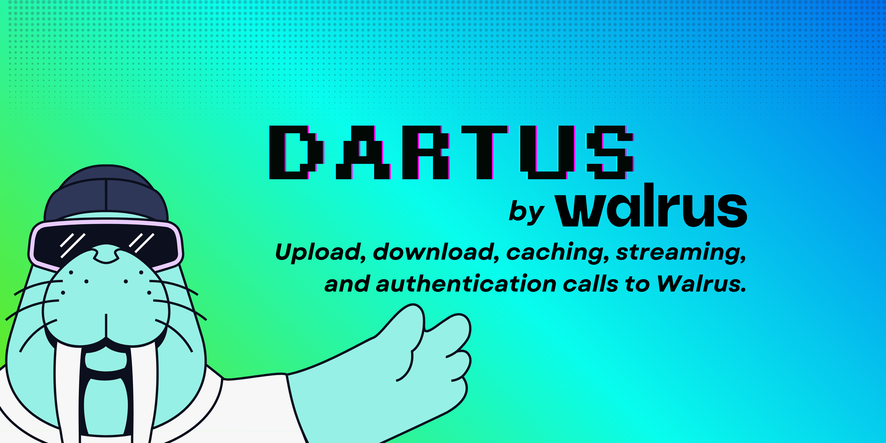

# Dartus



[](https://pub.dev/packages/dartus)
[](https://pub.dev/packages/dartus/score)
[](LICENSE)

Dartus is a Dart/Flutter SDK for [Walrus](https://walrus.xyz) blob storage. It provides publisher uploads, aggregator downloads, wallet transaction builders, quilts, and native erasure coding.

## Choose an API

| API | Import | Runtime and requirements |
|-----|--------|--------------------------|
| HTTP bytes: `WalrusClient.putBlob` / `getBlob` | `package:dartus/dartus.dart` | Native or Flutter web; publisher and aggregator endpoints |
| HTTP files: `putBlobFromFile`, `putBlobStreaming`, `getBlobAsFile`, `getBlobAsFileStreaming` | `package:dartus/dartus.dart` | Native only; uses `dart:io` files |
| Relay/direct: `WalrusDirectClient` and write flows | `package:dartus/direct.dart` | Native only; Sui client, wallet for writes, and valid encoding metadata |
| Built-in encoding: `WalrusBlobEncoder` | `package:dartus/direct.dart` | Native `libwalrus_ffi` required for encoding and decoding |

The HTTP publisher operator pays on-chain storage costs and may require authentication or charge for its service. Direct and relay writes use the user's wallet for SUI gas and WAL storage costs. A relay accepts the raw blob, but registration still needs valid metadata; the built-in metadata encoder uses FFI too.

The current direct paths still require work on Sui transport, certification, and metadata, and the direct storage-node HTTP client accepts invalid TLS certificates. Treat the native examples below as API examples, not a claim of mainnet readiness. See [SECURITY.md](SECURITY.md).

## Installation

Use Flutter with bundled Dart **>=3.11.0 <4.0.0** for this checkout and its dependencies.

```yaml
dependencies:
  dartus: ^0.3.0
```

If your app imports Sui types directly, also declare `sui: ^0.3.7` under dependencies. Then run:

```bash
flutter pub get
```

Version 0.3.0 is the [published release](https://pub.dev/packages/dartus). Local fixes in this checkout are not included in that hosted release until a new version is published. Use a local path dependency when testing these changes:

```yaml
dependencies:
  dartus:
    path: ../Dartus
```

The path must point from your app to this checkout. The byte-oriented HTTP API has a Chrome JavaScript runtime smoke test; this does not establish WebAssembly support or browser support for direct/FFI APIs.

## HTTP quick start

```dart
import 'dart:typed_data';

import 'package:dartus/dartus.dart';

WalrusClient createHttpClient() => WalrusClient(
  publisherBaseUrl: Uri.parse('https://publisher.walrus-testnet.walrus.space'),
  aggregatorBaseUrl: Uri.parse('https://aggregator.walrus-testnet.walrus.space'),
);

Future<Uint8List> uploadAndRead(WalrusClient client, Uint8List bytes) async {
  final response = await client.putBlob(data: bytes, deletable: true);
  final created = response['newlyCreated'] as Map<String, dynamic>?;
  final object = created?['blobObject'] as Map<String, dynamic>?;
  final certified = response['alreadyCertified'] as Map<String, dynamic>?;
  final blobId = object?['blobId'] ?? certified?['blobId'];
  if (blobId is! String || blobId.isEmpty) {
    throw const FormatException('Publisher did not return a blob ID');
  }
  return client.getBlob(blobId);
}
```

Create the client once, pass your bytes to `uploadAndRead`, and `await client.close()` when finished. Endpoint availability and browser CORS permissions depend on the publisher/aggregator. For an authenticated publisher, set `jwtToken` on the client or upload call; keep private service credentials out of browser bundles.

The exact functions live in [tool/quickstart_http.dart](tool/quickstart_http.dart). Their upload/read behavior is tested with an injected HTTP client for both `newlyCreated` and `alreadyCertified` responses. These tests do not perform a public upload.

### Downloads, caching, and timeouts

- `getBlob(blobId)` and `getBlobAsFile(...)` use the byte cache: files on native, memory in the browser. Cache capacity counts entries, not bytes.
- `getBlobByObjectId(objectId)` downloads through `/v1/blobs/by-object-id/<objectId>`.
- `getBlobAsFileStreaming(...)` always reads from the aggregator and bypasses cache reads and writes. It writes chunks to a temporary file with backpressure, writes the destination only on success (overwriting an existing file in place to keep its permissions and symlink target), and removes partial output on failure.
- `timeout` defaults to 30 seconds: one deadline for response headers, then an inactivity timeout between response-body events. A progressing transfer can take longer than 30 seconds overall. A stalled body raises `TimeoutException`; an HTTP error response raises `WalrusApiError` after its body is read. The headers deadline alone does not abort an underlying request.
- `BlobCache.cleanup()` clears stored data and permits reuse. `dispose()` waits for pending cache work, removes temporary storage, and rejects later operations. Explicitly supplied cache directories are kept on disposal.

For native streaming downloads, import `dart:io` and use:

```dart
Future<void> downloadToFile(
  WalrusClient client,
  String blobId,
  File destination,
) => client.getBlobAsFileStreaming(blobId: blobId, destination: destination);
```

## Native encoding setup

From the Dartus repository root, build the included Rust crate:

```bash
cd native
./build.sh release
```

Set a custom library path if it is not found automatically:

```bash
export WALRUS_FFI_LIB=/absolute/path/to/libwalrus_ffi.dylib
```

Use the appropriate `.so` or `.dll` library on other supported native targets. There is **no pure-Dart fallback**. `WalrusBlobEncoder.isNativeAvailable` checks availability; encoding/decoding throws `StateError` if the library cannot load. A custom `BlobEncoder` or precomputed metadata can serve certain relay paths, but does not make the native-only `direct.dart` entry point browser-compatible.

## Native API examples

These functions are checked against the current API in [tool/quickstart_examples.dart](tool/quickstart_examples.dart). They have not been used to submit live transactions as part of the documentation checks.

```dart
import 'dart:convert';
import 'dart:typed_data';

import 'package:dartus/direct.dart';
import 'package:sui/sui.dart';

WalrusDirectClient createNativeClient() => WalrusDirectClient.fromNetwork(
  network: WalrusNetwork.testnet,
  encoder: WalrusBlobEncoder(),
);

Future<Uint8List> readDirect(WalrusDirectClient client, String blobId) =>
    client.readBlob(blobId: blobId);

Future<WriteBlobResult> writeDirect(
  WalrusDirectClient client,
  SuiAccount signer,
) => client.writeBlob(
  blob: utf8.encode('Hello Walrus!'),
  epochs: 3,
  signer: signer,
  deletable: true,
);
```

Call `client.close()` when finished with the native client. `fromNetwork` uses the network's default relay where configured; its override parameter is named `uploadRelay`. A configured encoder is needed for direct decoding and for metadata when it is not provided separately.

### Separate wallet signing from the write flow

The flow runs in a native app. Supply an adapter that signs and executes a `Transaction` and returns the result map, including `digest` and `objectChanges` (or `effects` identifying the created blob). Merely building the certify transaction does not execute it.

```dart
Future<void> writeWithWallet(
  WalrusDirectClient client,
  String owner,
  Future<Map<String, dynamic>> Function(Transaction) signAndExecute,
) async {
  final flow = await client.writeBlobFlow(blob: utf8.encode('Hello Walrus!'));
  await flow.encode();
  final registerTx = await flow.register(
    WriteBlobFlowRegisterOptions(epochs: 3, owner: owner, deletable: true),
  );
  final txResult = await signAndExecute(registerTx);
  final digest = txResult['digest'];
  if (digest is! String) {
    throw const FormatException('Wallet did not return a transaction digest');
  }
  await flow.upload(
    WriteBlobFlowUploadOptions(digest: digest, txResult: txResult),
  );
  await signAndExecute(flow.certify());
}
```

`WriteBlobFlowRegisterOptions` takes `owner`, not `signer`. `register()` returns a future and must be awaited. Upload options take `digest` plus `txResult` or an explicit `blobObjectId`.

### Files and quilts

`WalrusFile.from` uses named arguments:

```dart
WalrusFile createTextFile() => WalrusFile.from(
  contents: utf8.encode('Hello, World!'),
  identifier: 'hello.txt',
  tags: {'type': 'text'},
);
```

Use `writeFiles` to upload a list as a quilt, and `getBlob` / `WalrusBlob.files()` to read a quilt. Local `WalrusFile.bytes()`, `.text()`, `.json()`, and `.getTags()` expose the content and metadata.

## TLS, authentication, and upload policy

The default `WalrusClient` transport uses platform TLS validation for HTTPS. Its `useSecureConnection` argument is retained for source compatibility and has no effect. If you inject `httpClient`, its transport policy applies. HTTP URLs are still allowed and are not encrypted.

This differs from `WalrusDirectClient`: its shared storage-node client currently accepts invalid certificates. Setting an HTTP client's compatibility flag does not fix that direct-mode behavior.

HTTP uploads default to `deletable: true`, but callers can pass `false`. Direct write APIs require an explicit value and also permit `false`. Defaults are not enforcement of a deletable-only policy. Review [SECURITY.md](SECURITY.md) before handling sensitive data or relying on deletion.

## Testing this checkout

Run from the Dartus repository root:

```bash
flutter pub get
flutter test --no-pub
dart analyze --fatal-infos
dart format --output=none --set-exit-if-changed lib test live_test tool
```

The default suite is deterministic and blocks external HTTP requests; controlled loopback servers and injected responses are allowed. Use Flutter's runner because some exported dependencies require `dart:ui`. Plain `dart test` works for isolated pure-Dart suites, but does not run the entire package.

Browser HTTP and memory-cache checks (Chrome must be installed):

```bash
flutter test --no-pub --platform chrome test/browser/http_browser_test.dart test/cache_regression_test.dart
```

Optional live reads are outside `test/`. Set `DARTUS_LIVE_AGGREGATOR`, `DARTUS_LIVE_BLOB_ID`, and `DARTUS_LIVE_EXPECTED_TEXT` to an existing fixture, then run:

```bash
flutter test --no-pub live_test/http_live_read_test.dart --tags integration
```

Live upload checks require separate explicit opt-in and a writable endpoint. See [CONTRIBUTING.md](CONTRIBUTING.md) for those commands and the expected environment. No live upload is part of CI. Passing tests or analysis is not a security audit or proof of a working mainnet transaction.

## Examples and API documentation

- The Flutter HTTP example lives in [example/](example/).
- [Dartus-Demo](https://github.com/Immadominion/Dartus-Demo) demonstrates the broader API; its direct paths have the same readiness limits described above.
- [Published API reference](https://pub.dev/documentation/dartus/latest/) describes the hosted release. Run `dart doc` for this checkout's API docs.
- [Contribution setup](CONTRIBUTING.md), [changelog](CHANGELOG.md), and [issue tracker](https://github.com/Immadominion/Dartus/issues).

## License

MIT — see [LICENSE](LICENSE).
